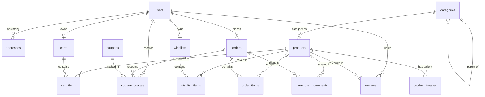

# Database Architecture & Schema Documentation

- **Database Name:** `ecommerce_store`
- **Engine:** MySQL 8.0 / InnoDB
- **Default Character Set:** `utf8mb4`
- **Default Collation:** `utf8mb4_unicode_ci`

---

## High-Level Entity-Relationship Model (Mermaid)

---

## Detailed Table Specifications (17 Tables)

### 1. `users`
Stores client and administrative credentials.
- `id`: INT AUTO_INCREMENT PRIMARY KEY
- `full_name`: VARCHAR(120) NOT NULL
- `email`: VARCHAR(191) NOT NULL UNIQUE
- `password_hash`: VARCHAR(255) NOT NULL
- `phone`: VARCHAR(30) NULL
- `role`: ENUM('CUSTOMER', 'ADMIN') DEFAULT 'CUSTOMER'
- `is_active`: TINYINT(1) DEFAULT 1
- `created_at`: TIMESTAMP DEFAULT CURRENT_TIMESTAMP
- `updated_at`: TIMESTAMP DEFAULT CURRENT_TIMESTAMP ON UPDATE CURRENT_TIMESTAMP

### 2. `addresses`
Shipping locations linked to customers.
- `id`: INT AUTO_INCREMENT PRIMARY KEY
- `user_id`: INT NOT NULL, FK -> `users(id)` ON DELETE CASCADE
- `full_name`: VARCHAR(120) NOT NULL
- `phone`: VARCHAR(30) NOT NULL
- `address_line1`: VARCHAR(255) NOT NULL
- `address_line2`: VARCHAR(255) NULL
- `city`: VARCHAR(100) NOT NULL
- `state`: VARCHAR(100) NULL
- `postal_code`: VARCHAR(20) NULL
- `country`: VARCHAR(100) DEFAULT 'Pakistan'
- `is_default`: TINYINT(1) DEFAULT 0
- `created_at`: TIMESTAMP DEFAULT CURRENT_TIMESTAMP
- `updated_at`: TIMESTAMP DEFAULT CURRENT_TIMESTAMP ON UPDATE CURRENT_TIMESTAMP

### 3. `categories`
Hierarchical catalog classification supporting nested parent/child relationships.
- `id`: INT AUTO_INCREMENT PRIMARY KEY
- `parent_id`: INT NULL, FK -> `categories(id)` ON DELETE SET NULL
- `name`: VARCHAR(120) NOT NULL
- `slug`: VARCHAR(150) NOT NULL UNIQUE
- `description`: TEXT NULL
- `image_url`: VARCHAR(500) NULL
- `is_active`: TINYINT(1) DEFAULT 1
- `display_order`: INT DEFAULT 0
- `created_at`: TIMESTAMP DEFAULT CURRENT_TIMESTAMP

### 4. `products`
Catalog items with pricing, inventory thresholds, and dimensional data.
- `id`: INT AUTO_INCREMENT PRIMARY KEY
- `category_id`: INT NULL, FK -> `categories(id)` ON DELETE SET NULL
- `name`: VARCHAR(200) NOT NULL
- `slug`: VARCHAR(220) NOT NULL UNIQUE
- `sku`: VARCHAR(80) NOT NULL UNIQUE
- `short_description`: VARCHAR(500) NULL
- `description`: TEXT NULL
- `price`: DECIMAL(12, 2) NOT NULL
- `compare_at_price`: DECIMAL(12, 2) NULL
- `stock_quantity`: INT NOT NULL DEFAULT 0
- `low_stock_threshold`: INT NOT NULL DEFAULT 5
- `is_active`: TINYINT(1) DEFAULT 1
- `is_featured`: TINYINT(1) DEFAULT 0
- `weight_kg`: DECIMAL(8, 3) NULL
- `dimensions_cm`: VARCHAR(80) NULL
- `created_at`: TIMESTAMP DEFAULT CURRENT_TIMESTAMP
- `updated_at`: TIMESTAMP DEFAULT CURRENT_TIMESTAMP ON UPDATE CURRENT_TIMESTAMP

### 5. `product_images`
Gallery photographs for each product.
- `id`: INT AUTO_INCREMENT PRIMARY KEY
- `product_id`: INT NOT NULL, FK -> `products(id)` ON DELETE CASCADE
- `image_url`: VARCHAR(500) NOT NULL
- `alt_text`: VARCHAR(200) NULL
- `is_primary`: TINYINT(1) DEFAULT 0
- `display_order`: INT DEFAULT 0
- `created_at`: TIMESTAMP DEFAULT CURRENT_TIMESTAMP

### 6. `carts`
Persistent shopping bag container for an authenticated user.
- `id`: INT AUTO_INCREMENT PRIMARY KEY
- `user_id`: INT NOT NULL UNIQUE, FK -> `users(id)` ON DELETE CASCADE
- `created_at`: TIMESTAMP DEFAULT CURRENT_TIMESTAMP
- `updated_at`: TIMESTAMP DEFAULT CURRENT_TIMESTAMP ON UPDATE CURRENT_TIMESTAMP

### 7. `cart_items`
Individual line items inside a customer's cart.
- `id`: INT AUTO_INCREMENT PRIMARY KEY
- `cart_id`: INT NOT NULL, FK -> `carts(id)` ON DELETE CASCADE
- `product_id`: INT NOT NULL, FK -> `products(id)` ON DELETE CASCADE
- `quantity`: INT NOT NULL DEFAULT 1
- `created_at`: TIMESTAMP DEFAULT CURRENT_TIMESTAMP
- `updated_at`: TIMESTAMP DEFAULT CURRENT_TIMESTAMP ON UPDATE CURRENT_TIMESTAMP
- CONSTRAINT: UNIQUE(`cart_id`, `product_id`)

### 8. `wishlists`
Customer wishlist container.
- `id`: INT AUTO_INCREMENT PRIMARY KEY
- `user_id`: INT NOT NULL UNIQUE, FK -> `users(id)` ON DELETE CASCADE
- `created_at`: TIMESTAMP DEFAULT CURRENT_TIMESTAMP

### 9. `wishlist_items`
Artifacts saved to a wishlist.
- `id`: INT AUTO_INCREMENT PRIMARY KEY
- `wishlist_id`: INT NOT NULL, FK -> `wishlists(id)` ON DELETE CASCADE
- `product_id`: INT NOT NULL, FK -> `products(id)` ON DELETE CASCADE
- `created_at`: TIMESTAMP DEFAULT CURRENT_TIMESTAMP
- CONSTRAINT: UNIQUE(`wishlist_id`, `product_id`)

### 10. `coupons`
Privilege vouchers with percentage or fixed discount formulas.
- `id`: INT AUTO_INCREMENT PRIMARY KEY
- `code`: VARCHAR(50) NOT NULL UNIQUE
- `discount_type`: ENUM('PERCENTAGE', 'FIXED') NOT NULL
- `discount_value`: DECIMAL(10, 2) NOT NULL
- `min_order_amount`: DECIMAL(12, 2) DEFAULT 0.00
- `max_discount_amount`: DECIMAL(12, 2) NULL
- `usage_limit`: INT NULL
- `used_count`: INT DEFAULT 0
- `per_user_limit`: INT DEFAULT 1
- `starts_at`: DATETIME NULL
- `expires_at`: DATETIME NULL
- `is_active`: TINYINT(1) DEFAULT 1
- `created_at`: TIMESTAMP DEFAULT CURRENT_TIMESTAMP

### 11. `orders`
Completed customer purchases fulfilled via Cash on Delivery.
- `id`: INT AUTO_INCREMENT PRIMARY KEY
- `order_number`: VARCHAR(50) NOT NULL UNIQUE
- `user_id`: INT NOT NULL, FK -> `users(id)`
- `coupon_id`: INT NULL, FK -> `coupons(id)` ON DELETE SET NULL
- `subtotal`: DECIMAL(12, 2) NOT NULL
- `discount_amount`: DECIMAL(12, 2) DEFAULT 0.00
- `delivery_fee`: DECIMAL(12, 2) DEFAULT 0.00
- `total_amount`: DECIMAL(12, 2) NOT NULL
- `payment_method`: ENUM('COD') DEFAULT 'COD'
- `payment_status`: ENUM('PENDING', 'PAID', 'FAILED') DEFAULT 'PENDING'
- `order_status`: ENUM('PENDING', 'PROCESSING', 'SHIPPED', 'DELIVERED', 'CANCELLED') DEFAULT 'PENDING'
- `shipping_name`: VARCHAR(120) NOT NULL
- `shipping_phone`: VARCHAR(30) NOT NULL
- `shipping_address_line1`: VARCHAR(255) NOT NULL
- `shipping_address_line2`: VARCHAR(255) NULL
- `shipping_city`: VARCHAR(100) NOT NULL
- `shipping_state`: VARCHAR(100) NULL
- `shipping_postal_code`: VARCHAR(20) NULL
- `shipping_country`: VARCHAR(100) DEFAULT 'Pakistan'
- `customer_note`: TEXT NULL
- `created_at`: TIMESTAMP DEFAULT CURRENT_TIMESTAMP
- `updated_at`: TIMESTAMP DEFAULT CURRENT_TIMESTAMP ON UPDATE CURRENT_TIMESTAMP

### 12. `order_items`
Line item snapshot taken at moment of order placement.
- `id`: INT AUTO_INCREMENT PRIMARY KEY
- `order_id`: INT NOT NULL, FK -> `orders(id)` ON DELETE CASCADE
- `product_id`: INT NOT NULL, FK -> `products(id)`
- `product_name`: VARCHAR(200) NOT NULL
- `product_sku`: VARCHAR(80) NOT NULL
- `unit_price`: DECIMAL(12, 2) NOT NULL
- `quantity`: INT NOT NULL
- `line_total`: DECIMAL(12, 2) NOT NULL
- `created_at`: TIMESTAMP DEFAULT CURRENT_TIMESTAMP

### 13. `coupon_usages`
Audit trail of coupon redemptions.
- `id`: INT AUTO_INCREMENT PRIMARY KEY
- `coupon_id`: INT NOT NULL, FK -> `coupons(id)` ON DELETE CASCADE
- `user_id`: INT NOT NULL, FK -> `users(id)` ON DELETE CASCADE
- `order_id`: INT NOT NULL, FK -> `orders(id)` ON DELETE CASCADE
- `discount_applied`: DECIMAL(12, 2) NOT NULL
- `used_at`: TIMESTAMP DEFAULT CURRENT_TIMESTAMP

### 14. `reviews`
Client testimonials and star ratings.
- `id`: INT AUTO_INCREMENT PRIMARY KEY
- `product_id`: INT NOT NULL, FK -> `products(id)` ON DELETE CASCADE
- `user_id`: INT NOT NULL, FK -> `users(id)` ON DELETE CASCADE
- `rating`: TINYINT NOT NULL CHECK (rating BETWEEN 1 AND 5)
- `title`: VARCHAR(150) NULL
- `comment`: TEXT NOT NULL
- `is_approved`: TINYINT(1) DEFAULT 1
- `created_at`: TIMESTAMP DEFAULT CURRENT_TIMESTAMP
- CONSTRAINT: UNIQUE(`product_id`, `user_id`)

### 15. `inventory_movements`
Ledger recording all inventory changes.
- `id`: INT AUTO_INCREMENT PRIMARY KEY
- `product_id`: INT NOT NULL, FK -> `products(id)` ON DELETE CASCADE
- `movement_type`: ENUM('ORDER', 'RESTOCK', 'ADJUSTMENT', 'RETURN') NOT NULL
- `quantity_change`: INT NOT NULL (negative for orders, positive for restock/cancellations)
- `resulting_stock`: INT NOT NULL
- `reference_id`: INT NULL (e.g. Order ID)
- `note`: VARCHAR(255) NULL
- `created_at`: TIMESTAMP DEFAULT CURRENT_TIMESTAMP

### 16. `store_settings`
Global operational thresholds and store parameters.
- `id`: INT AUTO_INCREMENT PRIMARY KEY
- `setting_key`: VARCHAR(100) NOT NULL UNIQUE
- `setting_value`: TEXT NOT NULL
- `description`: VARCHAR(255) NULL
- `updated_at`: TIMESTAMP DEFAULT CURRENT_TIMESTAMP ON UPDATE CURRENT_TIMESTAMP

### 17. `newsletter_subscribers`
Registered emails for marketing and exhibition journals.
- `id`: INT AUTO_INCREMENT PRIMARY KEY
- `email`: VARCHAR(191) NOT NULL UNIQUE
- `is_active`: TINYINT(1) DEFAULT 1
- `subscribed_at`: TIMESTAMP DEFAULT CURRENT_TIMESTAMP

